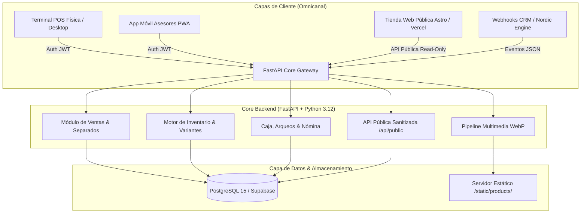

# 🧥 Estilo Nórdico — Headless Retail Engine (ERP, POS & Omnichannel API)

<p align="center">
  
  
  
  
  
  
</p>

---

## 📌 Executive Summary & Engineering Vision

**Estilo Nórdico Engine** es un ecosistema de software empresarial de alto rendimiento diseñado para resolver la fricción omnicanal en el sector retail y moda. Actúa como la **Fuente Única de Verdad (Single Source of Truth)** del negocio, orquestando en tiempo real:

1. **Terminal de Ventas Físicas (POS):** Facturación ultrarrápida, turnos de caja continuos, arqueos ciegos y control de pagos parciales (*Separados*).
2. **Motor de Inventario Jerárquico:** Despiece automatizado de variantes multimarca (`[REF]-[MARCA]-[COLOR]-[TALLA]`) y gestión inteligente de stock activo vs. archivo histórico.
3. **Plataforma Headless Omnicanal:** Exposición de endpoints públicos (`/api/public/*`) con **Data Transfer Objects (DTOs)** estrictamente sanitizados para alimentar la tienda web (Astro) y catálogos móviles sin exponer márgenes ni costos financieros.
4. **Pipeline Multimedia de Alto Rendimiento:** Conversión y compresión automática de imágenes a formato **WebP**, logrando una **reducción del 98.9% en peso** para cargas instantáneas en conexiones móviles.

---

## 📐 Topología y Arquitectura del Sistema

El ecosistema desacopla la lógica transaccional interna del consumo público mediante una arquitectura modular:



---

## 🚀 Hitos Técnicos & Decisiones de Arquitectura

### 1. Motor Headless con Protección contra Fuga de Datos
* **Aislamiento DTO (`ProductPublic`):** La API pública expone catálogos y stock en vivo a la web externa, omitiendo en el servidor los campos sensibles (`my_cost`, `cost_total`, `initial_stock`, datos de proveedores y márgenes).
* **Protección contra Doble Venta en Tiempo Real:** Endpoint micro-servicio `GET /api/public/stock-check/{id}` para validar disponibilidad atómica antes de despachar ventas por WhatsApp o delivery local.

### 2. Gestión Avanzada de Inventario & Despiece Matricial
* **Normalización Jerárquica:** Modelo relacional que agrupa productos base (*Padres*) con sus variantes hijas (*Talla, Color, Marca*) sin duplicar códigos de barras ni IDs.
* **Estandarización Automática de SKUs:** Generador algorítmico de identificadores normalizados:
  $$\text{SKU} = \text{REF} + \text{"-"} + \text{MARCA} + \text{"-"} + \text{COLOR} + \text{"-"} + \text{TALLA}$$
* **Inventario Dinámico (Activas vs. Archivo):** Filtro inteligente que segrega prendas con stock en piso (131 referencias) de referencias agotadas (104 referencias), reduciendo un **44% la carga visual** de las terminales y permitiendo reactivaciones en un clic (`+ Retomar`).
* **Ordenamiento Multinivel Estilo Hoja de Cálculo:** Algoritmo de ordenación jerárquico (`Hombre` $\to$ `Mujer` $\to$ `Subcategoría A-Z` $\to$ `Nombre A-Z`).

### 3. Pipeline de Optimización de Medios (WebP Engine)
* **Compresión Adaptativa:** Pipeline automatizado mediante `Pillow` que procesa capturas de alta resolución (PNG/JPG de 6 a 11 MB) y genera archivos WebP optimizados para retina display (50 a 80 KB).
* **Impacto:** Reducción de **52.2 MB a 0.56 MB** (**98.9% de ahorro de ancho de banda**), acelerando el Largest Contentful Paint (LCP) en la tienda virtual a menos de 0.8s.

### 4. Seguridad, RBAC y Zero-Trust
* **Autenticación Stateless JWT:** Tokens firmados criptográficamente mediante algoritmo `HS256`, con variables de entorno validadas al arranque.
* **Role-Based Access Control (RBAC):** Separación estricta de privilegios:
  * `Admin`: Control financiero, costos, auditoría de caja, gestión de personal.
  * `Vendedor`: Facturación POS, catálogo comercial, consulta de stock (costos bloqueados).
  * `Contador`: Reportes, exportación de balances, trazabilidad tributaria.
* **Hardening OWASP:** CORS dinámico configurable por lista blanca (`ALLOWED_ORIGINS`), hashing con `bcrypt` (límite seguro de 72 bytes) y `.gitignore` blindado contra volcados de base de datos (`*.sql`) y secretos (`.env`).

### 5. Frontend PWA & UX de Grado Comercial
* **Single Page Application con Vite:** Bundle minificado con chunking optimizado y soporte completo para instalación como Progressive Web App (PWA) en móviles de vendedores.
* **Diseño Responsive con Modo Colapsable:** Barra lateral retráctil a iconos para maximizar el área de trabajo en pantallas táctiles de 10" a 27".

---

## 💻 Tech Stack Detallado

| Capa | Tecnologías | Justificación Técnica |
| :--- | :--- | :--- |
| **Backend Core** | Python 3.12, FastAPI, Uvicorn | Asincronía nativa (`async/await`), tipado estático estricto con Pydantic v2 y rendimiento comparable a Node/Go. |
| **Persistencia** | PostgreSQL 15, SQLAlchemy 2.0 | Integridad referencial ACID, transacciones atómicas de stock y soporte directo para migración cloud a **Supabase**. |
| **Frontend UI** | React 18, Vite 5, Tailwind CSS | Reactividad inmediata para el cajero físico, diseño con utilidades atómicas y cero dependencias pesadas. |
| **Procesamiento Gráfico** | Pillow (PIL), WebP Encoder | Procesamiento de imágenes en el servidor para servir activos web ultra-livianos. |
| **Contenedores & Ops** | Docker, Docker Compose, Gitflow | Entornos reproducibles localmente y compatibilidad out-of-the-box para despliegue serverless en **Vercel** o VPS. |

---

## 📊 Endpoints Clave de la API (RESTful)

### 🔓 Públicos (Headless Storefront & Delivery Check)
| Método | Endpoint | Descripción |
| :--- | :--- | :--- |
| `GET` | `/api/public/products` | Catálogo filtrable por tipo, marca y stock (costos omitidos). |
| `GET` | `/api/public/products/{slug}` | Ficha de producto para SEO y páginas de detalle. |
| `GET` | `/api/public/categories` | Agrupación dinámica con conteo de prendas publicadas. |
| `GET` | `/api/public/stock-check/{id}` | Micro-chequeo atómico de disponibilidad en tiempo real. |

### 🔒 Protegidos (ERP, POS & Gestión Administrativa)
| Método | Endpoint | Rol Requerido | Descripción |
| :--- | :--- | :--- | :--- |
| `POST` | `/auth/login` | Público | Autenticación y expedición de Bearer JWT. |
| `GET/POST`| `/products/` | Vendedor / Admin | CRUD maestro de catálogo y desglose de variantes. |
| `GET/POST`| `/sales/` | Vendedor / Admin | Registro atómico de ventas y descuentos de inventario. |
| `POST` | `/sales/{id}/payments` | Vendedor / Admin | Registro de abonos a ventas bajo modalidad Separado. |
| `GET/POST`| `/cash/` | Admin | Movimientos de caja menor, base diaria y arqueos de turno. |
| `GET/PUT` | `/users/` | Admin | Administración de cuentas, roles y enlaces de invitación. |

---

## 🛠️ Instalación y Entorno de Desarrollo

### Requisitos Previos
* Docker & Docker Compose
* Python 3.12+
* Node.js 18+

### 1. Clonar el Repositorio
```bash
git clone https://github.com/Cristian-Ipaz07/estilo-nordico-app.git
cd estilo-nordico-app
```

### 2. Levantar Base de Datos (Docker)
```bash
docker-compose up -d db
```

### 3. Configurar Backend (FastAPI)
```bash
cd backend
cp .env.example .env
python -m venv venv
source venv/bin/activate  # En Windows: .\venv\Scripts\activate
pip install -r requirements.txt
uvicorn main:app --host 0.0.0.0 --port 8000 --reload
```

### 4. Iniciar Frontend (Vite)
```bash
cd ../frontend
npm install
npm run dev
```
Acceder a la aplicación web en: `http://localhost:5173`.

---

## 👤 Autor & Liderazgo Técnico
**Cristian Ipaz**
*Estudiante de Ingeniería de Sistemas (UNAD)*
*Lead Software Architect & Full-Stack Developer — Estilo Nórdico*
* San Juan de Pasto, Nariño, Colombia
* Enfoque: Arquitectura de software orientada a negocio, APIs de alto rendimiento y sistemas de retail omnicanal.
